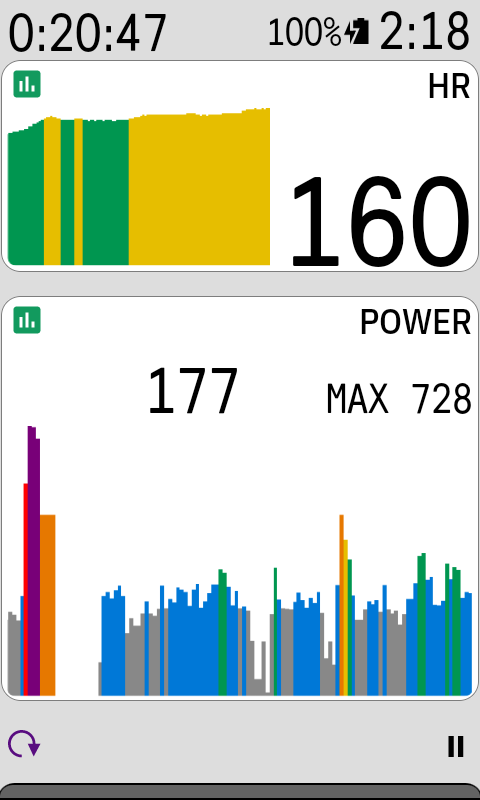

# Power Graph

A [Karoo](https://www.hammerhead.io/) extension that adds scrolling bar graph data fields for power, heart rate, cadence and speed. Each graph shows the last two minutes alongside the current value, colored by your training zones.



## Data fields

- **Power**: power, colored by power zone
- **HR**: heart rate, colored by heart rate zone
- **Cadence**: cadence
- **Speed**: speed, in km/h or mph following your Karoo's unit preference

On larger fields, each graph can also show ride statistics beside the current value: max, average and, for power, normalized power. Smaller fields switch to a compact layout.

## Installation

Power Graph runs on Karoo devices that support extensions (Karoo 2 and Karoo 3 with current firmware).

1. Download the latest `powergraph-<version>.apk` from the [Releases](https://github.com/acastiglia/powergraph/releases) page.
2. Install it on your Karoo using either method below.

### With the Hammerhead Companion app

1. Pair your Karoo with the Hammerhead Companion app on your phone.
2. On your phone, open the release page, long-press the APK link and share it to the Hammerhead Companion app.
3. Confirm the install on your Karoo.

### With adb

1. Enable developer options and USB debugging on the Karoo.
2. Connect it to your computer over USB and run:

   ```sh
   adb install -r powergraph-<version>.apk
   ```

## Settings

Open **Power Graph** from the Karoo's app drawer. Each data field has its own settings, and changes apply to fields already on screen.

- **Smoothing** (power and cadence): average the current value over 1, 3, 10 or 30 seconds. The graph still plots every reading.
- **Statistics**: choose which ride statistics appear beside the current value on larger fields.
- **Zone Colors** (power and heart rate): color the bars by training zone, or show plain gray bars.

## Building from source

Requirements: JDK 17 and the Android SDK (API 34). A `local.properties` with `sdk.dir`, or Android Studio, takes care of the SDK path.

The [karoo-ext](https://github.com/hammerheadnav/karoo-ext) library is served from GitHub Packages, which requires a GitHub personal access token with the `read:packages` scope. Add it to `~/.gradle/gradle.properties`:

```properties
gpr.user=<your GitHub username>
gpr.key=<your token>
```

Alternatively, set the `USERNAME` and `TOKEN` environment variables.

Then build and install a debug APK on a connected Karoo:

```sh
./gradlew installDebug
```

Run the unit tests with:

```sh
./gradlew testDebugUnitTest
```

### Release builds

`scripts/release.sh <tag>` builds a signed release APK from a git tag into `dist/powergraph-<version>.apk`. Signing reads `POWERGRAPH_KEYSTORE`, `POWERGRAPH_KEYSTORE_PASSWORD`, `POWERGRAPH_KEY_ALIAS` and `POWERGRAPH_KEY_PASSWORD` from `~/.gradle/gradle.properties`.

## License

[Apache License 2.0](LICENSE)

Built with [karoo-ext](https://github.com/hammerheadnav/karoo-ext).
